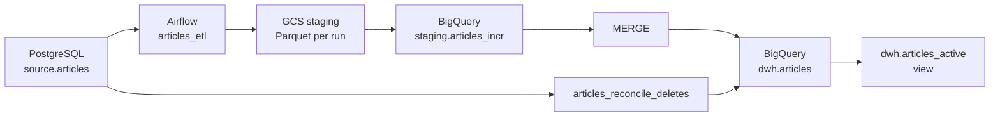

# Kumparan — Data Engineer Assessment 2026

An implementation of an **hourly ETL/ELT pipeline** from PostgreSQL as the source database to **Google BigQuery** as the data warehouse (DWH), orchestrated with Apache Airflow and using Google Cloud Storage (GCS) for intermediate file staging.

This project addresses the Data Engineer assessment requirements: making article data available for analytics, running the pipeline every hour, handling historical data dating back to 2016, and keeping the warehouse synchronized when the source uses **hard deletes**.

## Architecture

### Main Components

- **PostgreSQL 16** — source database containing the `articles` table.
- **Apache Airflow 2.10.5** — pipeline orchestration, running locally with Docker Compose and `LocalExecutor`.
- **Google Cloud Storage (GCS)** — stores extracted Parquet files for each pipeline run.
- **BigQuery** — staging area and data warehouse.
- **Docker Compose** — runs the complete local stack.

### Data Flow



## Pipelines

### 1. Hourly ETL — `articles_etl`

This DAG is scheduled to run every hour at minute `00`. It consists of three tasks:

1. **`init`**
   - Ensures that the `staging` and `dwh` datasets, tables, and view exist in BigQuery.
   - Initialization is idempotent, so it is safe to run repeatedly.

2. **`extract`**
   - Reads the watermark from `MAX(updated_at)` in `dwh.articles`.
   - Moves the watermark back by an **overlap window of 1 hour** to account for late-arriving changes and updates around run boundaries.
   - Extracts source rows whose `updated_at` is within the selected range, then writes them as Parquet files to GCS.
   - If the DWH is empty, the pipeline performs a **full load**.
   - Reads source data in chunks using a server-side cursor to avoid loading the entire dataset into memory at once.

3. **`load_and_merge`**
   - Loads the Parquet files into the temporary table `staging.articles_incr`.
   - Runs a `MERGE` into `dwh.articles` using `id` as the matching key.
   - A target row is updated only when the source `updated_at` is newer than or equal to the stored value. This makes the operation safe to retry (*idempotent*).

The same DAG also supports **backfills** through the `since` and `until` parameters, allowing historical ranges to be processed without changing the regular hourly schedule.

### 2. Daily Delete Reconciliation — `articles_reconcile_deletes`

An incremental ETL based on `updated_at` cannot detect rows that have been physically removed from the source. To handle **hard deletes**, a reconciliation DAG runs daily at **02:30 UTC**.

1. **`snapshot`**
   - Copies active article IDs from the DWH into `staging.articles_candidates` as the initial snapshot (t0).
   - Reads all article IDs still present in the source into `staging.articles_ids` as the subsequent snapshot (t1).
   - The snapshots are created sequentially to establish two distinct points in time for comparison.

2. **`mark_deleted`**
   - Finds IDs present in the DWH candidate snapshot but missing from the source snapshot.
   - Sets `deleted_at` for rows identified as deleted.
   - Includes safety checks: the task is aborted if the source returns zero IDs or if more than **5%** of candidates would be marked as deleted. This helps prevent accidental mass deletion caused by an unavailable source or incomplete snapshot.

3. **`check`**
   - Verifies that there are no duplicate IDs in the DWH table.

This reconciliation uses **soft deletes in the DWH**: rows are not physically removed; instead, their `deleted_at` field is populated. This preserves historical records while allowing BI consumers to use `dwh.articles_active` to query only active articles.

## Data Warehouse Objects

| Object | Purpose |
|---|---|
| `staging.articles_incr` | Holds the latest Parquet load for the incremental `MERGE`; overwritten on each run. |
| `staging.articles_candidates` | Snapshot of active DWH article IDs for delete reconciliation. |
| `staging.articles_ids` | Snapshot of all article IDs currently present in the source. |
| `dwh.articles` | Main table containing the latest version of each article, including rows with a populated `deleted_at`. |
| `dwh.articles_active` | View exposing only rows where `deleted_at IS NULL`, intended for analytics and BI consumers. |

The `dwh.articles` table is partitioned daily by `created_at` and clustered by `id`, `created_at`, and `updated_at`.

## Repository Structure

```text
kumparan/
├── .env.example
├── .gitignore
├── Dockerfile
├── docker-compose.yml
├── requirements.txt
├── dags/
│   ├── etl_common.py
│   ├── articles_etl.py
│   └── articles_reconcile_deletes.py
├── sql/
│   ├── ddl_source.sql
│   └── ddl_dwh.sql
├── scripts/
│   ├── download_dataset.py
│   ├── seed_source.py
│   └── bootstrap_gcp.sh
└── data/                         # created during setup; not committed
    └── raw/
        └── data.csv
```

### File and Directory Descriptions

**Configuration and infrastructure**

- `.env.example` — template for environment variables. Copy it to `.env` and provide your own values. The actual `.env` file must not be committed.
- `.gitignore` — excludes datasets, secrets, local environments, Python caches, and logs.
- `Dockerfile` — extends the official Apache Airflow 2.10.5 image with `pyarrow` for Parquet and BigQuery operations.
- `docker-compose.yml` — defines the PostgreSQL source, Airflow metadata database, Airflow initialization process, webserver, and scheduler.
- `requirements.txt` — dependencies for scripts executed directly on the host machine.

**DAGs**

- `dags/etl_common.py` — shared helpers for configuration, extraction, BigQuery operations, watermark handling, staging loads, `MERGE` SQL, and validation.
- `dags/articles_etl.py` — main hourly pipeline for full loads, incremental loads, and backfills.
- `dags/articles_reconcile_deletes.py` — daily pipeline for detecting hard deletes in the source.
- `dags/source_simulator.py` — optional DAG for randomly simulating inserts, updates, soft deletes, and hard deletes. **For local testing and demos only; do not point it at a production database.**

**SQL**

- `sql/ddl_source.sql` — PostgreSQL source `articles` schema, including the primary key, timestamp columns, `updated_at` index, and a trigger that updates `updated_at` whenever a row is updated.
- `sql/ddl_dwh.sql` — BigQuery DDL for datasets, DWH and staging tables, and the active-articles view.

**Scripts**

- `scripts/download_dataset.py` — downloads the article dataset from Hugging Face into `data/raw/`.
- `scripts/seed_source.py` — populates the source table from CSV. It removes the embedding column, fills missing timestamps, generates a synthetic `author_id` from a URL hash, and uses an insert strategy that is safe to run repeatedly.
- `scripts/bootstrap_gcp.sh` — creates the GCS staging bucket in `asia-southeast2` with a lifecycle rule that deletes objects after 7 days.

## Prerequisites

Make sure the following tools and resources are available:

- Docker Engine and Docker Compose
- Python 3
- Google Cloud CLI (`gcloud`)
- A Google Cloud project with the **BigQuery API** and **Cloud Storage API** enabled
- A GCP user or service account with sufficient permissions to create and manage buckets, datasets, tables, BigQuery jobs, and GCS objects

## Running the Project

### 1. Clone the repository

```bash
git clone https://github.com/Fadlrizki/kumparan.git
cd kumparan
```

### 2. Configure environment variables

```bash
cp .env.example .env
```

Fill in all variables defined in `.env.example`, including:

- `PROJECT_ID`
- `AIRFLOW_SECRET_KEY`
- `AIRFLOW_ADMIN_PASSWORD`
- `AIRFLOW_DB_PASSWORD`
- `SOURCE_DB_PASSWORD`

Use your own secret values. Never commit `.env` or GCP credentials to the repository.

### 3. Configure Google Cloud authentication

Authenticate using Application Default Credentials:

```bash
gcloud auth application-default login
gcloud config set project YOUR_PROJECT_ID
```

Make sure the ADC credentials are accessible to the container through the volume mount configured in `docker-compose.yml`.

### 4. Create the GCS staging bucket

Run the bootstrap script once:

```bash
bash scripts/bootstrap_gcp.sh
```

The script creates `gs://<PROJECT_ID>-kumparan-staging` in `asia-southeast2` and configures a lifecycle rule to delete objects after 7 days. If the bucket already exists, the script does not modify its existing lifecycle configuration.

### 5. Start the local stack

```bash
docker compose up -d --build
```

Docker Compose starts the PostgreSQL source and Airflow services. The source DDL is applied during the database's first initialization. Airflow initialization prepares the metadata database, admin user, and required pool.

Open the Airflow UI:

- URL: <http://localhost:8080>
- Username: `admin`
- Password: the `AIRFLOW_ADMIN_PASSWORD` value from `.env`

### 6. Download and seed the dataset

Install the dependencies for local scripts:

```bash
pip install -r requirements.txt
```

Download the dataset:

```bash
python scripts/download_dataset.py
```

Seed the PostgreSQL source:

```bash
python scripts/seed_source.py
```

To test with a limited number of rows, use `--limit`:

```bash
python scripts/seed_source.py --limit 10000
```

The script also provides `--history-2016 N` to add a number of synthetic rows dated in 2016 for historical backfill testing. Rows are skipped if 2016 data already exists. See all available options with:

```bash
python scripts/seed_source.py --help
```

### 7. Run the pipelines in Airflow

After the source has been populated and GCP connectivity is available:

1. Open the Airflow UI.
2. Make sure the `articles_etl` DAG is enabled.
3. Trigger the DAG manually for the initial execution, or wait for its hourly schedule.
4. The first run performs a full load if the DWH table is empty.
5. Enable `articles_reconcile_deletes` to run hard-delete reconciliation on its daily schedule.

The `source_simulator` DAG is optional and intended only for testing changes against the local source database.

## DATA

Articles come from the Hugging Face dataset `iqballx/indonesian_news_datasets`. `author_id` is synthetic. The 2016 rows are synthetic copies of existing articles with shifted dates, created only to test the backfill.

## Reliability and Data Quality

The pipeline includes the following safeguards and operational mechanisms:

- **Watermark with a 1-hour overlap** to reduce the chance of missing changes around run boundaries and to support recovery after temporary pipeline outages.
- **Idempotent `MERGE`** so the same data can be processed again without creating duplicate records.
- **Chunked extraction** using a server-side cursor to limit memory usage.
- **Retries, timeouts, and `max_active_runs=1`** to control DAG execution.
- **Airflow pool `dwh_write`** to manage tasks writing to the warehouse.
- **BigQuery `maximum_bytes_billed`** as a query cost guardrail.
- **Delete reconciliation safeguards** that abort if the source is empty or if more than 5% of candidates would be marked as deleted.
- **Duplicate checks** after reconciliation to validate ID uniqueness.

## Runtime Artifacts

The following artifacts are created in external services when the pipeline runs; they are not stored in the repository:

| Location | Contents |
|---|---|
| `gs://<PROJECT_ID>-kumparan-staging/articles/<ts>/part-*.parquet` | Extracted Parquet files for each run; objects are deleted after 7 days by the bucket lifecycle rule. |
| `staging.articles_incr` | Latest load from GCS used by the `MERGE` process. |
| `staging.articles_candidates` | Snapshot of active DWH IDs for reconciliation. |
| `staging.articles_ids` | Snapshot of source IDs for reconciliation. |
| `dwh.articles` | Main DWH table. |
| `dwh.articles_active` | Active-articles view for BI consumers. |

## Security Notes

- Do not commit `.env`, service account credential files, or other secrets.
- Use `.env.example` only as a template without secret values.
- ADC credentials are mounted read-only into the container as configured.
- Local service ports are bound to localhost as configured in Docker Compose.
- Use `source_simulator` only with the local test database, never with production data.

## AI Usage Disclosure

This project was built with heavy AI assistance (Claude, Anthropic). I want to be explicit
about how I worked with it.

**How I worked**
I defined the problem and the target flow, then used AI as my main implementation partner.
Most of the code (DAGs, helpers, SQL DDL, Docker setup, scripts) was generated by AI.
My role was to direct it, evaluate what it produced, test it end-to-end on my own GCP
project and local stack, debug what failed, and decide what to keep, change or drop.
Rather than rewrite things AI had already produced well, I focused on managing and
validating the solution.

**What I brought**
- The flow: Hugging Face dataset → PostgreSQL (source) → Parquet on GCS → BigQuery,
  orchestrated with Airflow.
- The initial skeleton: repository layout (`dags/`, `sql/`, `scripts/`), the Hugging Face
  download script, a simple Airflow DAG that inserts rows on a schedule, and a helper module.
- The environment: GCP project, bucket and authentication. Service-account keys were blocked
  by an organization policy, so I used Application Default Credentials.

**What AI generated**
- The full set of scripts, built out from my skeleton and flow description.
- A critical review of the first version (e.g. data-loss risk when combining a schedule-based
  window with `catchup=False`, partitioning on a mutable column, a race in delete reconciliation).
  The current design (watermark-based extraction, one DAG for full load/incremental/backfill,
  candidate snapshot for hard deletes) was written by AI in response to that review.
- Test procedures, error diagnosis, and the README structure and file descriptions.

**What I did with it**
- Reviewed the AI's critique and chose to adopt the redesign, and asked for the process to
  be simplified.
- Ran and verified the pipeline myself: [list only what you actually saw: full load,
  incremental load, soft/hard delete handling, idempotency, outage recovery, 2016 backfill].
- Debugged environment issues while running it (e.g. missing `.env` variables, shell quoting,
  Docker/Airflow setup).
- Made decisions: dropped the `_loaded_at` column, added synthetic 2016 data without a tag to
  exercise the backfill, and decided what to keep in the repo.
- Edited the documentation.

I did not write most of the code line by line. I understand the design and can explain
it, including why the watermark replaces a schedule-based window, why reconciliation reads
DWH candidates before source IDs, and why the MERGE is safe to repeat.
---

**Assessment:** Data Engineer Assessment 2026  
**Stack:** PostgreSQL · Apache Airflow · Docker Compose · Google Cloud Storage · BigQuery
